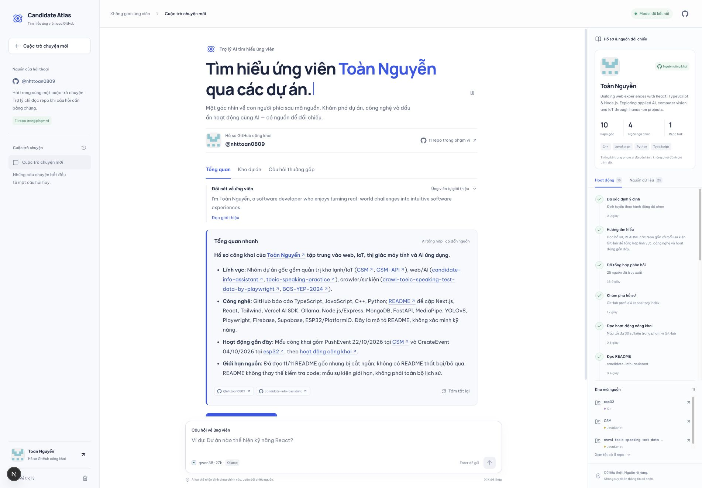
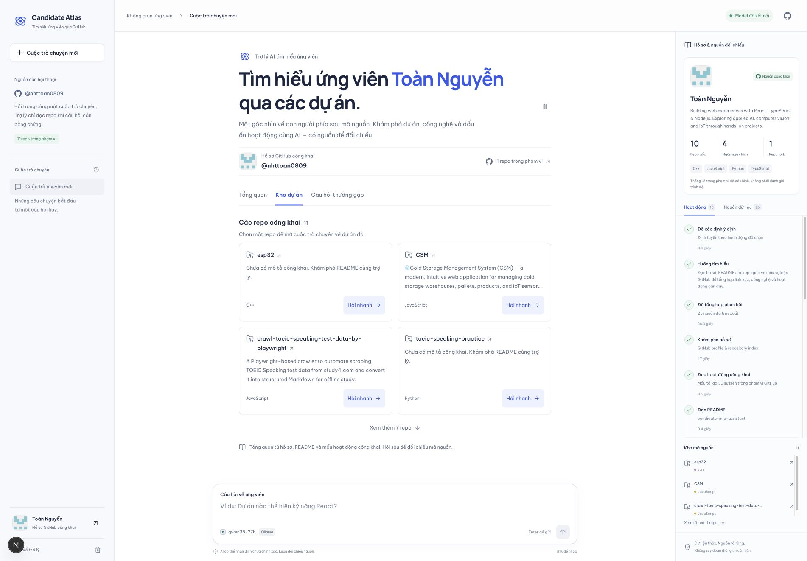
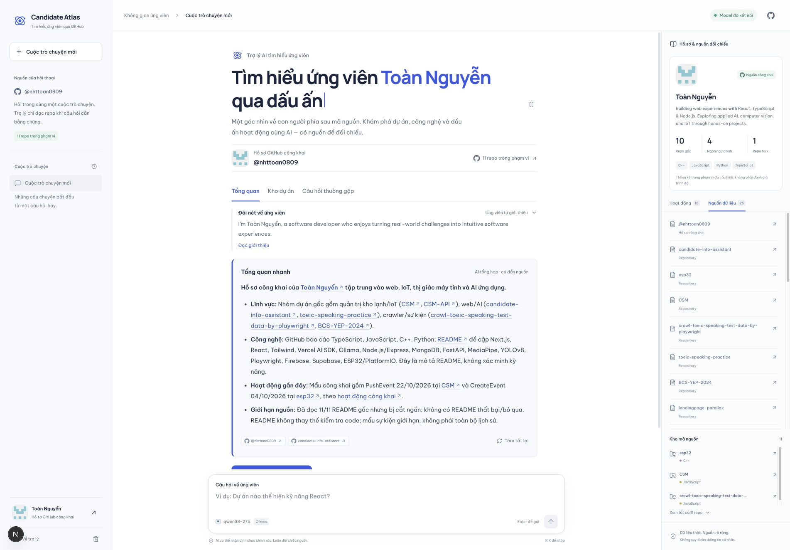

# Candidate Atlas · Khám phá ứng viên qua bằng chứng 🔎

> **Biến hồ sơ GitHub thành một cuộc trò chuyện có dẫn chứng: nhà tuyển dụng khám phá dự án, đặt câu hỏi về ứng viên và tự đối chiếu nhận định của AI với nguồn công khai.**

  <h3>🚀 Trải nghiệm Candidate Atlas trực tiếp</h3>
  
Khám phá hồ sơ, chọn dự án và đặt câu hỏi có nguồn đối chiếu.

  
  
<a href="https://candidate-atlas-drab.vercel.app"><strong>candidate-atlas-drab.vercel.app ↗</strong></a>

**Dự án của Toàn Nguyễn** · Phát triển ứng dụng web và AI agent

[Xem tính năng](#features) · [Tài liệu kỹ thuật & cài đặt](TECHNICAL.md)

_Ảnh chụp ứng dụng thực tế trên môi trường local. Dữ liệu và phản hồi thay đổi theo hồ sơ, model và thời điểm truy xuất._

---

## 📌 Executive Summary (Tổng quan dự án)

| Thông số               | Chi tiết                                                                                                 |
| :--------------------- | :------------------------------------------------------------------------------------------------------- |
| **Project Name**       | **Candidate Atlas** (`candidate-info-assistant`)                                                         |
| **Project Type**       | Portfolio hội thoại và trợ lý tìm hiểu ứng viên từ GitHub                                                |
| **Đối tượng sử dụng**  | Nhà tuyển dụng, người phỏng vấn và người muốn tìm hiểu dự án của ứng viên                                |
| **Phạm vi phát triển** | Trải nghiệm khám phá hồ sơ, hội thoại AI, hoạt động nghiên cứu và nguồn đối chiếu                        |
| **Trạng thái**         | Đã có tổng quan tự động, khám phá repo, hội thoại và truy xuất ảnh; cần kết nối model và GitHub khi chạy |

---

## 🎯 Problem & Solution (Bài toán & Giải pháp)

- **Problem:** Thông tin về ứng viên phân tán giữa hồ sơ, README và nhiều repository. Người phỏng vấn cần nhanh chóng hiểu dự án giải quyết vấn đề gì, chọn hướng đào sâu và biết đâu là nguồn cho từng nhận định.
- **Solution:** Cung cấp một không gian hội thoại tiếng Việt, nơi người đọc xem tổng quan, chọn dự án và đặt câu hỏi theo nhu cầu. Trợ lý truy xuất thông tin công khai, hiển thị nguồn đã đọc và phân biệt mô tả dự án với những điều chưa đủ bằng chứng để kết luận.

---

## ✨ Key Features (Tính năng nổi bật)

| Tính năng                           | Giá trị mang lại                                                                           |
| :---------------------------------- | :----------------------------------------------------------------------------------------- |
| **Tổng quan ứng viên có dẫn chứng** | Tập hợp góc nhìn từ hồ sơ, README và mẫu hoạt động công khai, kèm giới hạn của nguồn       |
| **Kho dự án & hỏi nhanh**           | Chọn một repo để mở cuộc trò chuyện về bài toán, cách xây dựng và điểm đáng tìm hiểu       |
| **Hội thoại có nguồn đối chiếu**    | Đi từ câu hỏi tới phản hồi, đồng thời xem các bước tìm kiếm và tài liệu đã được đọc        |
| **Ảnh thật từ repository**          | Tìm screenshot của dự án trong phạm vi cấu hình và đính kèm nguồn để người đọc tự kiểm tra |
| **Tiếp tục hành trình khám phá**    | Lưu hội thoại trên thiết bị, đặt câu hỏi tiếp nối, dừng hoặc thử lại khi cần               |

### 🗂️ Khám phá dự án theo nhu cầu phỏng vấn

Chuyển giữa **Tổng quan**, **Kho dự án** và **Câu hỏi thường gặp**. Mỗi dự án có thao tác hỏi nhanh, giúp bắt đầu từ một chủ đề cụ thể thay vì phải tự đọc toàn bộ kho mã.

### 🔗 Nhận định đi cùng nguồn tham khảo

Bảng bên phải cho phép chuyển giữa **Hoạt động** và **Nguồn dữ liệu**. Người đọc có thể mở hồ sơ hoặc README đã được truy xuất để đối chiếu câu trả lời.

_Candidate Atlas hỗ trợ tìm hiểu ứng viên, không thay thế phỏng vấn hoặc xác minh hồ sơ. Nội dung công khai và phản hồi AI có thể thiếu hoặc chưa chính xác; việc dùng một công nghệ không tự chứng minh trình độ, thâm niên hay đóng góp cá nhân._

---

## 👨‍💻 Competencies & Contributions (Năng lực & Đóng góp)

- **Tư duy sản phẩm:** Kết nối nhu cầu đọc hồ sơ, khám phá dự án và đặt câu hỏi trong cùng một hành trình dành cho người phỏng vấn.
- **Xây dựng AI có khả năng đối chiếu:** Tổ chức truy xuất bằng chứng, nguồn tham khảo và thông báo giới hạn thay vì chỉ trình bày câu trả lời.
- **Thiết kế trải nghiệm tương tác:** Phối hợp hội thoại, hồ sơ, kho dự án và hoạt động agent; quan tâm tới thao tác bàn phím và thiết bị di động.
- **Xử lý trạng thái thực tế:** Thể hiện quá trình chờ, dừng, lỗi kết nối và phản hồi chưa hoàn tất để người dùng biết điều gì đang diễn ra.

---

## 📈 Future Roadmap (Hướng phát triển)

- [ ] Mở rộng tình huống đánh giá chất lượng câu trả lời và độ phù hợp của nguồn.
- [ ] Cải thiện trải nghiệm chờ khi model phản hồi chậm hoặc cần đọc nhiều dự án.
- [ ] Bổ sung hướng dẫn triển khai lâu dài cho endpoint model và vận hành ứng dụng công khai.

---

## 👤 Author & Contact

- **Tác giả:** Toàn Nguyễn
- **GitHub:** [@nhttoan0809](https://github.com/nhttoan0809)
- **Tài khoản sinh viên (cùng tác giả):** [@toanb1805926](https://github.com/toanb1805926)

---

## 📄 License

Xem [thông tin giấy phép và tài nguyên bên thứ ba](TECHNICAL.md#license).
