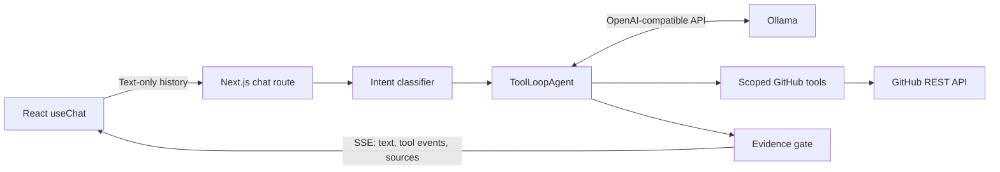

# Technical Guide · Candidate Atlas

[Tổng quan dự án và năng lực thể hiện](README.md)

Tài liệu dành cho lập trình viên và agents. Các lệnh chạy tại thư mục gốc `candidate-info-assistant`; đọc [AGENTS.md](AGENTS.md) trước khi chỉnh mã nguồn.

[Phạm vi](#scope) · [Skills & Tech Stack](#stack) · [Kiến trúc & API](#architecture) · [Cài đặt](#setup) · [Điểm kỹ thuật](#highlights) · [Hướng cải thiện](#roadmap) · [Tham khảo](#references) · [Giấy phép](#license)

<a id="scope"></a>

## 📍 Implementation Scope (Phạm vi triển khai)

Ứng dụng fullstack đọc GitHub công khai trong phạm vi một owner hoặc repository được cấu hình. Dùng model qua endpoint OpenAI-compatible, có thể chạy Ollama local. Không thực thi code của repository được khảo sát, không dùng vector database và không phải hệ thống quyết định tuyển dụng tự động.

| Thành phần    | Trách nhiệm                                                                  | Trạng thái / Giới hạn                                         |
| :------------ | :--------------------------------------------------------------------------- | :------------------------------------------------------------ |
| Workspace     | Hồ sơ, ba tab khám phá, hội thoại, activity/evidence và ảnh dự án            | Lịch sử ở localStorage; không có database tài khoản           |
| Agent         | Phân loại ý định, tổng quan, hỏi nhanh repository và nghiên cứu theo câu hỏi | Cần model hỗ trợ tool calling; có giới hạn bước/thời gian     |
| GitHub client | Scope, phân trang, cache, đọc file và truy xuất ảnh có nguồn                 | Chỉ dữ liệu công khai, chịu quota GitHub                      |
| API           | Profile, health và SSE chat                                                  | Biến cấu hình chỉ phía server; kiểm tra request và rate limit |
| Vận hành      | Script build/test/smoke và cấu hình Vercel                                   | Endpoint Ollama phải truy cập được từ môi trường deploy       |

### Các giới hạn cần biết

- Chất lượng và tốc độ phụ thuộc model và phần cứng. Lượt nhiều tool có thể mất hàng chục giây; activity hiển thị ngay để người dùng theo dõi.
- Ollama OpenAI-compatible chưa hỗ trợ `tool_choice` trên phiên bản đã kiểm tra. Ứng dụng giới hạn `activeTools` theo bước; model vẫn có thể bỏ qua tools, vì vậy cần evidence gate.
- Template Qwen3 4B cũ có thể không tắt thinking đúng qua `reasoning_effort=none`. Dùng `provider-default` để reasoning được trả ở trường riêng và không gửi ra UI, hoặc cập nhật model/template. Model 1.7B đã thử phản hồi nhanh nhưng có lúc bỏ qua tool; không nên chọn làm agent chính nếu chưa kiểm chứng.
- Nguồn là dữ liệu repo công khai, không phải CV được ứng viên xác nhận. Repository text có thể sai; chống prompt injection chỉ giảm rủi ro, không bảo đảm mọi suy luận của LLM chính xác.
- Chỉ đọc file văn bản nhỏ hơn 100 KB và cắt nội dung quá dài; không parse PDF CV. README hoặc CV dạng Markdown được hỗ trợ.
- Nếu `/api/health` trả 503: kiểm tra tunnel, model name và auth. Nếu GitHub giới hạn quota: cấu hình token ở server hoặc đợi quota hồi phục.

---

<a id="stack"></a>

## 🛠 Skills & Tech Stack (Kỹ năng & Công nghệ)

| Nhóm                  | Công nghệ theo package.json                                     | Vai trò                                              |
| :-------------------- | :-------------------------------------------------------------- | :--------------------------------------------------- |
| UI / server           | Next.js `^16.4.2`, React `^19.3.1`, TypeScript                  | App Router, API routes và workspace                  |
| Styling               | Tailwind CSS `^4.3.3`, Lucide, Manrope, Be Vietnam Pro          | Responsive UI, biểu tượng và font phục vụ cục bộ     |
| Agent                 | AI SDK `^7.0.143`, `@ai-sdk/react`, `@ai-sdk/openai-compatible` | ToolLoopAgent, useChat và data stream                |
| Validation / nội dung | Zod 4, React Markdown, remark-gfm                               | Hợp đồng dữ liệu và hiển thị Markdown                |
| Model                 | Ollama / OpenAI-compatible endpoint                             | Inference và phân loại; model do môi trường cấu hình |
| Chất lượng            | Vitest 5, Playwright, ESLint, Prettier                          | Unit, browser tests, lint và định dạng               |
| Runtime / hosting     | Node.js `22.x`, npm, Vercel                                     | Runtime được khóa trong engines; deploy Next.js      |

- **Kỹ năng kỹ thuật thể hiện:** scope enforcement, tool orchestration, SSE streaming, evidence validation, hủy request, quản lý lịch sử client và kiểm thử ranh giới dữ liệu.
- **Nguồn cấu hình:** [package.json](package.json), [package-lock.json](package-lock.json), [next.config.ts](next.config.ts), [vercel.json](vercel.json).
- Phiên bản trên là range khai báo, không phải cam kết phiên bản mới nhất. `@typescript/native` dùng compiler TypeScript 7; alias `typescript` cung cấp API TypeScript 6 cho công cụ lint.

---

<a id="architecture"></a>

## 🏗 System Architecture & API Design (Kiến trúc & Thiết kế API)

### System Architecture



### Repository Structure

```text
src/app/api/chat/       Validation, rate limit, streaming, cancellation
src/app/api/health/     Kiểm tra endpoint và model được cấu hình
src/app/api/profile/    Làm mới dữ liệu hồ sơ
src/components/        Workspace, conversation, inspector, responsive drawers
src/lib/agent/         Classifier, model, tools, agent, evidence gate
src/lib/github.ts      GitHub scope, cache, quotas, bounded text retrieval
src/lib/env.ts         Zod environment schema
tests/                 Các ranh giới dữ liệu và lỗi thực tế
AGENTS.md              Mục tiêu, kiến trúc và quy tắc cho coding agent
```

### API / Routes / Protocols

| Method | Endpoint       | Contract / Chức năng                                                                               |
| :----- | :------------- | :------------------------------------------------------------------------------------------------- |
| `GET`  | `/`            | Workspace React                                                                                    |
| `GET`  | `/api/profile` | Bootstrap: tên ứng dụng, model, scope, hồ sơ, repo, bio; trả 503 khi không truy xuất được          |
| `GET`  | `/api/health`  | Gọi `/models` ở endpoint đã cấu hình; 200 nếu tìm thấy model, 503 khi thiếu model hoặc mất kết nối |
| `POST` | `/api/chat`    | Nhận hội thoại text hoặc entry action đã validate; trả AI SDK UI-message SSE                       |

Chat có kiểm tra same-origin với request trình duyệt, rate limit và giới hạn body 200 KB. Lịch sử chat thông thường nhận tối đa 30 messages, mỗi text part tối đa 10.000 ký tự; chỉ giữ 16 messages text cuối và tổng nội dung tối đa 40.000 ký tự. Client tool outputs không trở thành bằng chứng tin cậy.

Các entry `overview` và `repository` được kiểm tra và dựng prompt từ server tại [entry.ts](src/lib/agent/entry.ts). `repository` cần `MAX_AGENT_STEPS >= 3`. SSE gồm text cùng `data-progress`, `data-classification`, `data-activity`, `data-sources`, `data-images` và `data-usage`; không chuyển nội dung reasoning nội bộ ra giao diện.

---

<a id="setup"></a>

## 🚀 Getting Started (Cài đặt & Chạy thử)

### Prerequisites & Installation

Clone repository rồi cài theo lockfile:

```bash
git clone https://github.com/nhttoan0809/candidate-info-assistant.git
cd candidate-info-assistant
```

Yêu cầu Node.js 22, npm và Ollama đang chạy với model hỗ trợ tool calling.

```bash
npm ci
cp .env.example .env.local
# Sửa REPO_URL, MODEL_URL, MODEL_NAME trong .env.local
npm run dev
```

Mở `http://localhost:3000`. Ollama dùng endpoint OpenAI-compatible, ví dụ `http://localhost:11434/v1`; không cần OpenAI API key. `MODEL_API_KEY` chỉ cần nếu gateway của bạn yêu cầu xác thực.

Ví dụ cấu hình:

```dotenv
REPO_URL=https://github.com/your-github-username
MODEL_URL=http://localhost:11434/v1
MODEL_NAME=qwen3:4b
CLASSIFIER_MODEL_NAME=qwen3:1.7b
MODEL_REASONING_EFFORT=provider-default
```

`REPO_URL` nhận một tài khoản hoặc `https://github.com/owner/repository`. Chế độ repo chỉ cho đọc repo được cấu hình; thông tin profile công khai của owner vẫn có thể được truy vấn. Không cần thay code để chuyển ứng viên. Các biến này **chỉ ở máy chủ**, không có `NEXT_PUBLIC_`.

### Configuration

| Biến                                                 | Ý nghĩa                                                                                    |
| ---------------------------------------------------- | ------------------------------------------------------------------------------------------ |
| `MODEL_URL`                                          | Base URL OpenAI-compatible, có `/v1`                                                       |
| `MODEL_NAME`                                         | Model đã cài trong Ollama, cần hỗ trợ tools                                                |
| `CLASSIFIER_MODEL_NAME`                              | Tùy chọn; mặc định cùng model chính                                                        |
| `MODEL_REASONING_EFFORT`                             | `provider-default`, `none`, `low`, `medium`, `high`; phải phù hợp model                    |
| `MODEL_API_KEY`                                      | Tùy chọn nếu endpoint yêu cầu Bearer auth                                                  |
| `REPO_URL`                                           | GitHub account hoặc repo cụ thể                                                            |
| `GITHUB_TOKEN`                                       | Tùy chọn; tăng quota REST. Ứng dụng vẫn chỉ cho đọc dữ liệu công khai                      |
| `APP_NAME`                                           | Tên sản phẩm                                                                               |
| `MODEL_TIMEOUT_MS`                                   | Deadline cả lượt; mặc định 240000 ms                                                       |
| `CLASSIFIER_TIMEOUT_MS`                              | Deadline classifier; mặc định 20000 ms                                                     |
| `GITHUB_TIMEOUT_MS`                                  | Deadline mỗi request GitHub; mặc định 12000 ms                                             |
| `MAX_AGENT_STEPS`                                    | Mặc định 5, từ 2 đến 8; lượt cuối dành cho tổng hợp                                        |
| `MAX_OUTPUT_TOKENS`                                  | Giới hạn mỗi lần sinh; mặc định 4096 (tối đa cấu hình 12000), gồm reasoning khi model dùng |
| `MAX_PROJECT_IMAGES`                                 | Số ảnh tối đa mỗi dự án, mặc định 4, từ 1 đến 8 (tối đa 12 ảnh mỗi phản hồi)               |
| `MAX_REPOSITORIES`                                   | Mặc định 50, tối đa 100 repo trong phạm vi                                                 |
| `GITHUB_CACHE_SECONDS`                               | Cache trong instance; mặc định 300 giây                                                    |
| `UPSTASH_REDIS_REST_URL`, `UPSTASH_REDIS_REST_TOKEN` | Tùy chọn nhưng phải đi cùng nhau; limiter chung giữa các Vercel instance                   |

Các cấu hình bổ sung trong [src/lib/env.ts](src/lib/env.ts) và [.env.example](.env.example):

| Biến                   | Ý nghĩa                                                                                         |
| :--------------------- | :---------------------------------------------------------------------------------------------- |
| `CANDIDATE_BIO`        | Giới thiệu công khai tùy chọn, tối đa 2.400 ký tự; trống thì dùng bio GitHub. Không chứa secret |
| `MAX_OVERVIEW_READMES` | Số README gốc được chọn ở bước tổng quan, mặc định 12, khoảng 1–30                              |

Giới hạn chat là 10 lượt/phút/IP. Khi chưa cấu hình Redis, limiter và cache ở bộ nhớ từng instance, phù hợp demo; chúng không cung cấp quota thống nhất qua nhiều instance. Lịch sử chỉ lưu ở localStorage, tối đa 12 cuộc trò chuyện; có nút xóa trên thiết bị.

### Production Build

```bash
npm run build
npm start
```

Development mặc định tại `http://localhost:3000`; dùng `npm run dev -- --port 3002` nếu cổng đang bận. Chạy Ollama ở terminal riêng; cài model trùng với `MODEL_NAME`, và `CLASSIFIER_MODEL_NAME` nếu tách classifier. Ví dụ tải model cấu hình mẫu:

```bash
ollama pull qwen3:4b
ollama pull qwen3:1.7b
```

Không gọi `npm run deploy` khi chỉ cần xem local: script đó publish production qua Vercel.

---

<a id="highlights"></a>

## 🔍 Implementation Highlights (Điểm kỹ thuật & Module)

### Agent, scope và evidence

- **Phân loại ý định:** chào hỏi, cảm ơn và hướng dẫn rõ ràng được định tuyến trực tiếp, không gọi model/GitHub. Câu hỏi ứng viên dùng structured output bởi model; lỗi/timeout hoặc nhãn mâu thuẫn từ khóa rõ ràng trong câu hỏi chuyển sang định tuyến từ khóa tiếng Việt/Anh. UI ghi rõ chế độ. `CLASSIFIER_MODEL_NAME` có thể dùng model nhỏ hơn trên cùng endpoint.
- **Lập hướng tìm hiểu:** bản tóm tắt công khai theo ý định, có thể xem trong activity; không giả lập hay tiết lộ suy nghĩ nội bộ.
- **Tool calling:** `discover_candidate` đọc profile và danh sách repo; `inspect_repository` đọc README, languages, dependencies và root paths; `read_repository_file` đọc file văn bản an toàn; `find_project_images` tìm và đính kèm ảnh thật của một repo. Model chọn công cụ và tham số; SDK quản lý vòng lặp có giới hạn.
- **Bằng chứng:** UI chỉ hiển thị câu trả lời sau khi có dữ liệu lấy bằng tool. Nếu model bỏ qua tool, nội dung chưa kiểm chứng bị chặn và trả lỗi có hướng xử lý. Liên kết Markdown chỉ bấm được khi khớp nguồn đã truy xuất. Ảnh chỉ được hiển thị từ metadata đã kiểm tra của tool, không tải URL ảnh do model tự chèn.
- **Streaming:** `createUIMessageStream` kết hợp activity, classification, sources, usage và stream agent. Có dừng phản hồi, retry và tiếp nối hội thoại.
- **Tổng quan tự động:** vào trang sẽ streaming một lần bản giới thiệu ngắn, dùng chung khi đổi hoặc tạo hội thoại mới, có nhấn mạnh và nguồn trong panel riêng. Prompt phía server tại `src/lib/agent/entry.ts`; truy xuất inventory bắt buộc, không thêm câu hỏi tự động vào lịch sử chat. Giữ luồng tổng quan khi đổi hội thoại, chỉ hủy khi rời workspace hoặc chủ động dừng; chỉ thử lại khi người dùng yêu cầu.
- **Hỏi nhanh repo:** danh sách repo trên màn hình chính có nút mở hội thoại riêng. Server kiểm tra tên/phạm vi repo, bắt buộc discovery và inspect đúng repo trước khi phản hồi theo ba ý: bài toán, cách xây dựng, điểm nên đào sâu. Dùng `SMOKE_ACTION=overview npm run smoke` hoặc `SMOKE_ACTION=repository SMOKE_REPOSITORY=<tên-repo> npm run smoke` để kiểm tra model thật.
- **Hồ sơ trung thực:** không suy tuổi nghề từ tuổi tài khoản, không coi dependency là chứng chỉ trình độ, không nhận công upstream từ repo fork. CV, công ty, học vấn, liên hệ chỉ xuất hiện khi có nguồn công khai tương ứng.

Đây là agent truy xuất theo yêu cầu, không dùng vector DB. Mỗi lượt có thể đọc GitHub mới hoặc cache ngắn hạn; nguồn file giúp recruiter tự đối chiếu. Không tải hay thực thi code từ repo.

### Verification

```bash
npm run format         # Định dạng code và sắp xếp class Tailwind
npm run format:check   # Kiểm tra định dạng
npm run lint           # ESLint: Next.js, React và TypeScript
npm run lint:fix       # Tự sửa các lỗi lint có thể sửa
npm run check          # Prettier + ESLint + TypeScript + unit tests
npm run build          # Production build
npm run test:e2e       # UI với SSE fixture, Chrome headless; không gọi model
npm run smoke          # Model thật + tools + sources + streaming trên localhost
SMOKE_URL=https://your-app.vercel.app npm run smoke
SMOKE_QUESTION='Phân tích repo cụ thể và dẫn nguồn' npm run smoke
```

Smoke test không mock phản hồi; với câu hỏi nghiên cứu, nó yêu cầu ít nhất một tool call, một nguồn, câu trả lời không rỗng và stream hoàn chỉnh. Với `SMOKE_QUESTION=Hello`, nó yêu cầu phản hồi không có tool/source. Nó cũng phát hiện một số mẫu reasoning lọt vào text. Không chạy đồng thời nhiều smoke trên máy có ít RAM vì Ollama xử lý tuần tự hoặc phải load lại model.

Prettier dùng `prettier-plugin-tailwindcss` với stylesheet Tailwind v4 tại `src/app/globals.css`. File CSS này chỉ giữ import, token và keyframe; style component nằm trong class Tailwind. Các thuộc tính `data-ui` là hook ổn định cho selector trạng thái và browser test.

ESLint dùng flat config (`eslint.config.mjs`), Core Web Vitals, TypeScript và `eslint-config-prettier` để tránh xung đột định dạng. Theo [hướng dẫn cài song song của TypeScript](https://devblogs.microsoft.com/typescript/announcing-typescript-7-0/#running-side-by-side-with-typescript-6.0), `@typescript/native` giữ compiler 7 (`tsc`), còn alias `typescript` cung cấp API 6 cho `typescript-eslint`.

Đặt `PLAYWRIGHT_PORT=3002 npm run test:e2e` nếu cổng 3000 đã được ứng dụng khác sử dụng.

Browser tests dùng Chrome đã cài trên máy (`channel: chrome`). Chúng kiểm tra desktop, 375px, keyboard drawers, nguồn SSE, lịch sử và retry; model thật được kiểm tra riêng bằng smoke.

Kiểm tra UI ở desktop và mobile: nhập Enter / Shift+Enter, nút Dừng, retry khi offline, mở/đóng drawer bằng Escape, nguồn dẫn chứng, chuyển và xóa lịch sử. `⌘/Ctrl+K` đưa focus về ô hỏi. Giao diện tôn trọng reduced motion.

### Deployment & Operations

```bash
vercel link
vercel env add MODEL_URL production
vercel env add MODEL_NAME production
vercel env add REPO_URL production
# Thêm CLASSIFIER_MODEL_NAME / GITHUB_TOKEN nếu cần, lặp lại cho preview.
vercel --prod
```

Dùng Vercel MCP nếu đã kết nối; CLI hoạt động với cùng dự án. Không đưa `.env.local` vào source upload. `.vercelignore` loại skills, dữ liệu test, build cục bộ và env. `vercel.json` chọn Next.js và vùng Singapore; chat route có `maxDuration=300`.

Vercel không truy cập được `localhost` của máy chạy Ollama. Đặt `MODEL_URL` trên Vercel thành tunnel HTTPS đang hoạt động, ví dụ `https://<tunnel-host>/v1`. Cloudflare Quick Tunnel đổi URL khi khởi động lại; cập nhật biến môi trường **và redeploy**. Với endpoint lâu dài, dùng hostname/tunnel ổn định và xác thực qua `MODEL_API_KEY` nếu gateway hỗ trợ.

### Trạng thái chờ, timing và token budget

Sidebar quản lý các cuộc trò chuyện thật và nguồn đang cấu hình. Các gợi ý nghiên cứu ở màn hình chào chỉ là câu hỏi mẫu, không phải những chế độ chat riêng.

`useChat.status=streaming` chỉ có nghĩa đã nhận chunk SSE, chưa có nghĩa model đã sinh câu trả lời. Trước chữ đầu tiên có thể lần lượt có thời gian phân loại, Ollama tải/đợi model, reasoning ẩn, tool GitHub và lượt tổng hợp tiếp theo. Trước đây indicator chỉ bám `submitted` nên biến mất ngay khi nhận metadata. Hiện indicator tồn tại đến text đầu tiên và lấy phase từ sự kiện server thật, với bộ đếm thời gian, nút Dừng và giải thích sau 15 giây. Không hiển thị tiến độ phần trăm giả hay nội dung reasoning.

`data-usage` ghi `classificationMs`, `firstModelEventMs`, `firstTextMs` và tổng thời gian. `firstModelEventMs` là sự kiện reasoning/text/tool đầu tiên mà ứng dụng nhận, không phải chỉ số thời gian load model từ Ollama. Dùng smoke log để đối chiếu mốc nhận SSE và text. Thời gian tải model và chờ hàng đợi cần log/metrics tại Ollama để tách riêng.

Cảnh báo câu trả lời bị cắt do ứng dụng đọc `finishReason=length`, không phải một câu do model viết và không chứng minh giới hạn cố định của model. Ngân sách mỗi lần sinh gồm cả reasoning; 2200 token có thể hết trước khi câu trả lời kết thúc. Cách giảm tạm thời đã áp dụng: mặc định **4096** token và yêu cầu kết luận ngắn **120–220 từ**, thêm hành động **Nhận bản tóm tắt** (một lượt mới tối đa 100 từ, đọc lại nguồn như thường). Không tự động retry vô hạn hoặc giấu trạng thái bị cắt. Có thể thử 6000 nếu vẫn thường xuyên hết ngân sách, nhưng phải theo dõi deadline 240 giây của ứng dụng và 300 giây của route Vercel.

Để giảm chờ lâu dài, cập nhật template Qwen3 rồi kiểm tra `MODEL_REASONING_EFFORT=none` có thực sự hoạt động trên model đó; không bật mù quáng vì template 4B cũ đã từng trộn suy nghĩ vào text. Giữ model nóng và tránh luân phiên classifier/model trên phần cứng ít RAM nếu việc load lại chiếm phần lớn độ trễ. `CLASSIFIER_MODEL_NAME` có thể đặt cùng `MODEL_NAME`; đổi cấu hình này cần đo lại thay vì mặc định model nhỏ luôn nhanh hơn.

### Hình ảnh dự án và nguồn được kiểm tra

Agent có tool `find_project_images(repository)` cho câu hỏi ảnh/screenshot và câu tiếp nối như “Cung cấp hình ảnh trực quan về ứng dụng đó được không?”. Classifier ưu tiên nhánh `images` thay vì hướng dẫn khả năng của trợ lý. Với câu chỉ tham chiếu “ứng dụng đó” mà chưa có ngữ cảnh ứng viên, trợ lý hỏi lại; khi có ngữ cảnh, model nhận lịch sử text để chọn đúng repo. `inspect_repository` cũng tìm screenshot, nên câu hỏi giới thiệu ứng dụng có thể kèm ảnh ngay cả khi không yêu cầu ảnh riêng.

Ảnh được lấy từ cây file công khai của repo đã cấu hình, ưu tiên ảnh README theo thứ tự xuất hiện, sau đó các thư mục screenshot/demo. Hỗ trợ ảnh raster PNG/JPEG/WebP/GIF/AVIF dưới 5 MB; bỏ logo, icon, badge, SVG và texture chung. Tham chiếu Markdown tương đối, Markdown reference và HTML img được đối chiếu với file thực sự tồn tại. Không truy cập website tùy ý, không dùng ảnh stock, không tạo ảnh thay thế. Ảnh chỉ nằm ở host ngoài repo hoặc GitHub user-attachments hiện chưa được đính kèm tự động.

`data-images` stream metadata riêng: repo, path, alt, nguồn README/file, URL raw và URL GitHub ghim theo commit. Gallery chỉ chấp nhận URL raw GitHub có cùng commit/path với nguồn đã truy xuất và đúng scope. Các ảnh xuất hiện ngay sau tool, có alt, lazy loading, liên kết mở kích thước gốc, nguồn file và fallback khi tải lỗi. Metadata ảnh lưu cùng hội thoại, nhưng khi gửi lượt tiếp theo client vẫn chỉ gửi lịch sử text; ảnh cũ không trở thành bằng chứng đáng tin từ client.

Model text hiện tại không phân tích pixel. Chú thích dùng alt của README hoặc tên file; không coi nội dung ảnh là đã được model hiểu bằng thị giác. Không thấy ảnh thì báo phạm vi đã tìm; lỗi API hoặc cây file bị cắt phải được phân biệt với việc repo không có ảnh.

```bash
SMOKE_QUESTION='Cho xem screenshot repo CSM' SMOKE_EXPECT_IMAGES=1 npm run smoke
SMOKE_PRIOR_QUESTION='Giới thiệu ứng dụng trong repo CSM' SMOKE_QUESTION='Cung cấp hình ảnh trực quan về ứng dụng đó được không?' SMOKE_EXPECT_IMAGES=1 npm run smoke
```

---

<a id="roadmap"></a>

## 📈 Learnings & Technical Roadmap (Bài học & Hướng cải thiện)

### Key Learnings

- Streaming metadata không đồng nghĩa đã có token trả lời: cần trạng thái chuẩn bị và mốc timing riêng.
- Tool calling của model cần evidence gate, giới hạn scope và validation nguồn, không thể chỉ dựa vào instruction.
- Unit/browser tests với fixture xác nhận hành vi xác định; model thật và GitHub cần smoke test riêng.
- Model nhỏ hơn không mặc định nhanh hơn khi phải đổi model trên phần cứng ít RAM.

### Technical Roadmap

Các mục sau là đề xuất từ phạm vi triển khai hiện tại.

- [ ] Bổ sung tập đánh giá factuality, citation coverage và chất lượng chọn ảnh.
- [ ] Theo dõi latency theo phase và quota khi vận hành nhiều instance.
- [ ] Hoàn thiện hướng dẫn endpoint model ổn định và kiểm tra phục hồi sau mất kết nối.
- [ ] Bổ sung pipeline CI tự động cho các kiểm tra hiện có.

---

<a id="references"></a>

## 📚 References (Tài liệu liên quan)

- [AGENTS.md](AGENTS.md): phạm vi, quy tắc agent và yêu cầu kiểm chứng.
- [Định hướng thiết kế](docs/design.md): bố cục, typography và khả năng tiếp cận.
- [Nguồn ảnh giao diện](docs/screenshots/SOURCES.md): môi trường chụp và phạm vi minh chứng.
- [.env.example](.env.example): danh sách cấu hình; [scripts/smoke.ts](scripts/smoke.ts): xác minh endpoint/model thực.
- [TECHNICAL_TEMPLATE.md](TECHNICAL_TEMPLATE.md): bản mẫu gốc để tái sử dụng; placeholder trong file template không phải cấu hình của ứng dụng.

---

<a id="license"></a>

## 📄 License

[package.json](package.json) khai báo **ISC**, nhưng repo chưa có file `LICENSE` chứa điều khoản và thông tin chủ sở hữu. Cần bổ sung file giấy phép để làm rõ việc phân phối. Thư viện, font và dữ liệu GitHub có điều khoản riêng; không suy ra quyền sử dụng tài nguyên bên thứ ba từ giấy phép ứng dụng.
